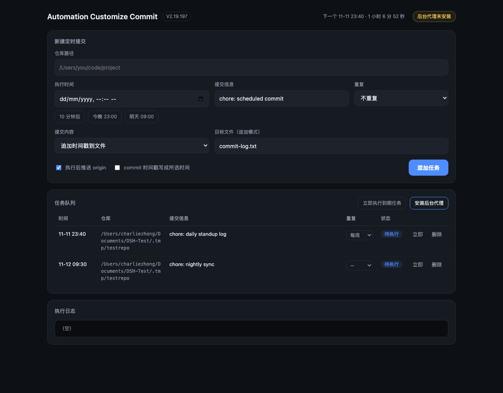

# Automation Customize Commit · V2.19.200

按**你自己选的时间**自动执行 `git commit`，并按需推送到 GitHub。图形界面 + 命令行 + 后台守护代理，零第三方依赖（只用 Python 标准库和 git）。



## 它解决什么

平时想固定在某个时间点提交（每日构建记录、周报、定时快照），但那个时间人不在电脑前。这个工具让你提前登记「几点、在哪个仓库、提交什么」，到点由后台代理自己跑，关掉界面也不影响。

## 快速开始

```bash
./run.command                 # 打开图形界面
```

窗口中填：仓库路径 → 执行时间 → 提交信息 → 选择提交内容 → 添加任务。任务列表里可以改重复频率、点「立即」跳过等待、点「删除」撤销。

首次使用点右上角 **安装后台代理**：它会写入一个 launchd 任务，每 60 秒检查一次到期任务。装一次即可，之后关掉浏览器也照常执行。

命令行等价用法：

```bash
python3 -m commit_auto.cli add --repo ~/code/proj --at "2026-11-12 09:30" -m "chore: nightly sync"
python3 -m commit_auto.cli list
python3 -m commit_auto.cli run          # 手动执行所有到期任务
python3 -m commit_auto.cli install      # 安装 launchd 代理
```

## 三种提交内容

| 模式 | 行为 |
| --- | --- |
| 追加时间戳到文件 | 往指定文件追加一行 `时间 提交信息`，只提交这个文件。默认 `commit-log.txt`，适合当每日打卡记录 |
| 提交仓库全部改动 | `git add -A` 后提交，把你手上未提交的改动一并交上去 |
| 空提交 | `git commit --allow-empty`，不改任何文件 |

## 重复计划

任务可设为 **每天** 或 **每周**。执行成功后会按原时间自动排下一次，不会漂移到实际执行时刻。任务列表里那一列下拉框可以直接改。失败时不会排下一次，会按原时间继续重试。

## 两个时间开关

- **执行时间**：任务到点才跑，早于当前时间的任务会在下一次轮询立即执行。
- **commit 时间戳写成所选时间**（`--backdate`）：把 `GIT_AUTHOR_DATE` / `GIT_COMMITTER_DATE` 设成你选的那个时间。适合补历史，但 push 后 GitHub 显示的提交时间就是这个回填值，不是真实执行时间。

## 时间戳的硬边界

Git 内部是 Unix 时间戳，普通 git 命令不接受负值，所以 **1969 年及更早无法作为正常提交时间**：`git commit` 报 `invalid date format`，强行写入被 fsck 判 `badDate`。

还有一个时区技巧：`GIT_AUTHOR_DATE="@0 -1200"`（epoch 0 + 负时区）能写出对象，`git cat-file` 里确实是 `0 -1200`，但**本机 `git log` 立刻报 `fatal: Timestamp before Unix epoch`**，仓库历史在本地就无法正常浏览。CLI 保留了 `--raw-date` 供实验，不建议在真实仓库用。

最早可用：`1970-01-01 00:00:00 UTC`（`@0 +0000`）。

## 失败重试

commit 或 push 失败会记 `error` 并累计次数，最多重试 5 次，每次轮询都会再试。日志见界面底部，文件在 `.state/run.log`。

## 全自动提交（sha256）

```bash
python3 -m commit_auto.auto --repo ~/code/proj --interval 300
```

常驻进程：每轮生成一个随机 sha256 写进 `hashes.log`，提交信息取前 16 位，然后推送。`--interval` 控制节奏，`--count` 限制轮数（0 = 无限），`--push-every` 控制推送频率。PID 写在 `.state/auto.pid`，`kill $(cat .state/auto.pid)` 即可停止。

## 历史回填

```bash
python3 -m commit_auto.backfill --repo ~/code/proj --start 1970-01-01 --step 1
```

用 `git fast-import` 一次性写出从起始日期到今天的每日提交（2 万条约 0.5 秒），不产生文件改动，工作区保持干净。仅用于时间戳研究：GitHub 贡献图只统计最近 12 个月，回填 1970 年不会多出绿色格子。

## 立即执行

任务列表每行有「立即」按钮，无视计划时间马上跑一次（`--id` 同理）。适合先验证配置对不对，再让它按时间自己跑。

## 目录结构

```
commit_auto/engine.py   任务存储、时间解析、git 执行
commit_auto/agent.py    launchd 守护代理安装/卸载
commit_auto/gui.py      本地 Web 界面（127.0.0.1，仅本机可访问）
commit_auto/cli.py      命令行
tests/test_engine.py    引擎单元测试（真实临时 git 仓库）
```

## 测试

```bash
python3 -m unittest discover -s tests
```

## 版本

当前 V2.19.197，版本号在 `VERSION` 文件，界面标题与 CLI `--version` 都从这里读。

- **V2.19.197** 重复计划（每天 / 每周）、单条立即执行、下一个任务倒计时
- **V2.19.196** 基线：调度引擎、launchd 后台代理、本地 Web GUI、CLI、9 项单元测试

## 说明

- 状态目录 `.state/` 默认在项目内，可用环境变量 `COMMIT_AUTO_HOME` 覆盖。
- 后台代理只在 macOS 上实现（launchd）。其他系统请用 cron 调用 `python3 -m commit_auto.cli run`。
- 回填时间戳会改变提交在 GitHub 上呈现的时间线，请只用于自己的仓库。
